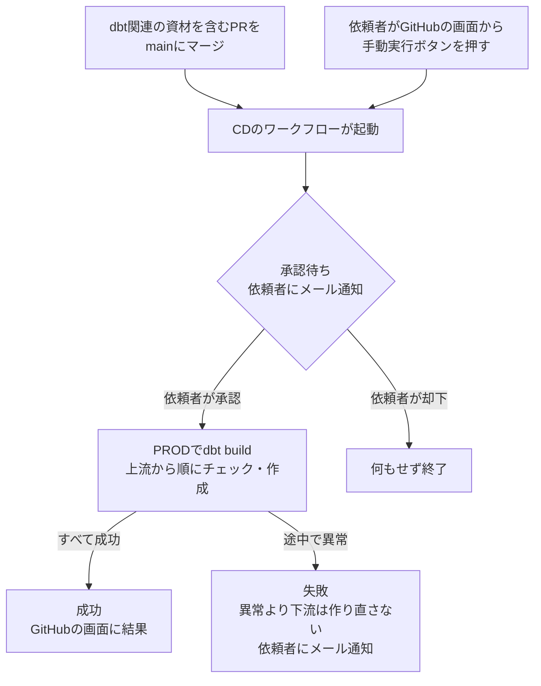

# 基本設計書（作業単位）

## 概要
GitHub Actionsに、dbtをPROD環境へリリースするワークフロー（CD）を追加する。リリースの承認には、GitHubのEnvironments機能（承認者を指定した「承認待ち」を挟める機能）を使う。

- dbtに関係しない資材（ドキュメントのみ等）のマージでは、ワークフローは起動しない
- PRODへの接続には、CD専用のSnowflakeユーザーを新しく作り、`TRANSFORMER_PROD`ロールのみを付与する

## 開発の分割
分割しない。

## 設計内容

### 作るもの

| 作るもの | 場所 | 内容 |
|---|---|---|
| CDのワークフロー | `.github/workflows/dbt-release.yml` | 起動条件・承認待ち・dbtの実行を定義する |
| 承認の設定（Environment） | GitHubのリポジトリ設定（Environment名：`prod`） | 承認者・実行を許可するブランチ・秘密情報を持つ |
| CD専用のSnowflakeユーザー | Snowflake（ユーザー名：`SVC_DBT_PROD`） | CDがPRODへ接続するためのユーザー |
| リリース手順書 | `.steering/20261012-dbt-cd/release.md` | 上記ユーザーの作成等、CDでは済まない本番作業の手順 |

### リリースの契機
- **マージ時**：`main`へのpushのうち、以下のいずれかに変更があった場合のみ起動する
    - `dbt/`配下のすべて（モデル・YAML・マクロ・テスト・`profiles.yml`等）
    - `requirements.txt`（dbtのバージョンが変わるため）
    - `.github/workflows/dbt-release.yml`（CD自体の変更）
- **手動実行**：GitHubのActionsの画面から、依頼者がボタンで起動できる（新しいデータの取り込み後の作り直し等）。`main`以外のブランチを指定しても、Environment側の設定で実行を拒否する

### リリースの承認
- Environment `prod`の承認者（Required reviewers）に依頼者（`tomitayuuki`）を設定する。ワークフローは承認されるまでPRODへの処理を一切始めない
- 承認待ちになると、GitHubから依頼者にメールが届く。承認はGitHubの画面上のボタンで行う
- 承認画面には、起動の契機（どのコミット＝どのマージか、手動実行なら誰が押したか）が標準で表示される。追加の表示は作らない
- 承認待ちのまま放置した場合、30日で自動的に取り消される（GitHubの仕様）
- リリースは同時に1つだけ動かす。先の実行（承認待ち・実行中）がある間に次のリリースが起動した場合、次のリリースは先の実行の後ろで待ち、後ろで待つリリースはさらに新しいリリースに置き換わる（後ろで待つのは常に最新の1件）。承認後に実行中のリリースは途中で止めない（dbtの処理を途中で止めると、一部のモデルだけが作り直された状態になるため）
    - 先の承認待ちを承認すると、先のリリースの後に最新のリリースが承認待ちになるため、最終的には`main`の最新の状態がリリースされる。先の承認待ちが不要な場合は却下してよい
    - GitHubの仕様上、承認待ちの実行が後ろの実行を待たせるのか、後ろの実行に置き換わるのかは、CIレビューでの指摘を受けてマージ後に実際の挙動を確認する（テストケース一覧No.16）。異なっていた場合は、実施記録のPRで本書・`docs/development-standards.md`4.5.3の記述を修正する

### リリースの処理
承認後、以下を順に行う。

1. リポジトリの内容を取得する
2. Python（3.13）を用意し、`requirements.txt`からdbtを導入する（ローカルと同じバージョンになる）
3. GitHubに登録した秘密鍵を、実行環境の一時ファイルに書き出す
4. `dbt build --target prod`を実行する
5. 一時ファイルの秘密鍵を削除する（成功・失敗にかかわらず実行する）

- `dbt build`は、モデルの作成とテストを依存関係の順に行うコマンド。上流（source・staging）のテストが失敗すると、それより下流（mart）の作成を飛ばすため、martは前回の状態のまま残る
- 接続設定は既存の`dbt/profiles.yml`の`prod`をそのまま使い、環境変数（`SNOWFLAKE_ACCOUNT`・`SNOWFLAKE_USER`・`SNOWFLAKE_PRIVATE_KEY_PATH`）にCD用の値を渡す。`profiles.yml`自体は変更しない

### リリースの結果の確認
- 成功・失敗は、GitHubのActionsの画面で確認する。ログには、モデルごと・テストごとの成功／失敗と処理件数が表示される
- 失敗した場合は、GitHubから依頼者にメールが届く（GitHubの標準の通知）。成功時はメールは届かない
- dbtの実行結果のファイル（`target/`）は、成果物としてアップロードしない（後述「設計判断とその根拠」の公開範囲を参照）

### CD専用のSnowflakeユーザー

| 項目 | 設定 |
|---|---|
| ユーザー名 | `SVC_DBT_PROD` |
| 種別 | サービスユーザー（`TYPE = SERVICE`。パスワード・MFAを持たず、キーペア認証のみでログインする） |
| 付与するロール | `TRANSFORMER_PROD`のみ（既定のロールにも設定する） |
| 既定のウェアハウス | `MAIN_WH` |
| 認証 | 新しく作るキーペア（依頼者の個人ユーザーの鍵とは別） |

- キーペアは依頼者がローカルで作成し、公開鍵をSnowflakeのユーザーに、秘密鍵をGitHubのEnvironment `prod`の秘密情報（Secrets）に登録する。秘密鍵は、ローカルに残さず登録後に削除する（再作成が必要になった場合は、作り直して登録し直す）
- `TRANSFORMER_PROD`は、既存のmart等を作ったロールと同じため、既存のテーブルをそのまま作り直せる

### GitHubに登録する値（Environment `prod`）

| 名前 | 種類 | 内容 |
|---|---|---|
| `SNOWFLAKE_ACCOUNT` | Secret | アカウント識別子 |
| `SNOWFLAKE_PRIVATE_KEY` | Secret | `SVC_DBT_PROD`の秘密鍵 |

- ユーザー名（`SVC_DBT_PROD`）は秘密として扱わないため、ワークフローに直接書く
- Environmentに登録したSecretsは、承認されたジョブからしか読めない。承認前やPRのCIからは読めない

### 作業の分担
| 作業 | 実施者 | タイミング |
|---|---|---|
| ワークフローの作成、ローカルでの確認 | Claude | 実装時 |
| GitHubのEnvironment `prod`の作成（承認者・ブランチの制限） | Claude | 実装時（マージ前） |
| キーペアの作成、`SVC_DBT_PROD`の作成、Secretsの登録 | 依頼者 | マージ後（リリース手順書） |
| マージで起動したリリースの承認、手動実行の確認、受け入れテスト | 依頼者 | マージ後（リリース手順書） |

- 本作業のPRは`.github/workflows/dbt-release.yml`を含むため、マージすると最初のリリースが起動し、承認待ちになる。依頼者は承認待ちの間にユーザー作成・Secretsの登録を行い、その後に承認する
- Environmentはマージ前に作っておく。Environmentが無い状態でワークフローが起動すると、承認の設定が無いEnvironmentが自動で作られ、承認を挟まずに実行されてしまうため

### CD導入後のリリース手順書の扱い
- dbtのリリースのみの作業では、リリース手順書を作らない。決まった手順は`docs/development-standards.md`に記載する（後述「永続ドキュメントへの反映」）
- 受け入れテストは、リリース手順書が無い場合は要件定義書の末尾に「受け入れテストの結果」の章を設けて記録する。完了条件と1対1で対応させ、リリース後に別のPRで`main`に取り込む（これまでの実施記録と同じ流れ）
- dbt以外の本番作業がある場合は、これまでどおりリリース手順書を作り、受け入れテストも手順書で行う（本作業がこれに該当する）

## テーブル定義
該当なし（テーブル・列の追加・変更は無い）。

## 設計判断とその根拠

### CDの仕組み：GitHub Actions
| 案 | 評価 |
|---|---|
| **A. GitHub Actions（採用）** | CIで既に使っており、追加の契約・費用が無い。承認待ち（Environments）も標準機能で持つ |
| B. dbt Cloud | dbt公式のマネージドサービス。スケジュール実行等も持つが、有料プランが前提で、月額1,000円未満の予算（`docs/requirements.md`）に収まらない |
| C. AWS（CodePipeline等） | 承認ステップを持つが、GitHub・AWS・Snowflakeの3者の連携が必要で、構成が重い |

### リリースのコマンド：`dbt build`
| 案 | 評価 |
|---|---|
| A. `dbt run`→`dbt test`（これまでの手動リリースと同じ） | すべてのモデルを作り直してからテストするため、上流のデータ異常があってもmartが作り直される |
| **B. `dbt build`（採用）** | 依存関係の順に「テスト→作成」を進め、失敗した箇所より下流を飛ばす。要件「上流で異常が見つかった場合はmartを前回の状態のまま残す」を満たす |
| C. 作成用のスキーマで作ってからテストし、成功したら入れ替える（Blue/Green） | mart自体の異常も防げるが、スキーマの入れ替えの仕組みと権限の追加が必要で大掛かり。要件で「防げなくてよい」と合意済み |

### PRODへの接続：CD専用のサービスユーザー
| 案 | 評価 |
|---|---|
| A. 依頼者の個人ユーザーの秘密鍵をGitHubに登録する | 追加の作業は少ないが、個人ユーザーは全ロール（`LOADER_PROD`等）を持つため、鍵が漏れた場合の影響範囲が基盤全体に及ぶ |
| **B. CD専用のユーザーを作り、`TRANSFORMER_PROD`のみを付与する（採用）** | 鍵が漏れても、影響はANALYTICS_PRODの作り直しとRAW_PRODの参照に限られる。鍵を個別に無効化・作り直しできる。実務でも、自動処理には人とは別のユーザー（サービスアカウント）を使うのが一般的 |

- これに伴い、`docs/architecture.md`の「ユーザーは1つ」の方針を「人が使うユーザーは1つ、自動処理（CD）用のサービスユーザーを別に持つ」に変更する
- GitHubからSnowflakeへの接続元を制限する設定（ネットワークポリシー）は設けない。GitHubが提供する実行環境の接続元のIPアドレスは非常に多く頻繁に変わるため、現実的に制限できない。キーペア認証のみでのログインと、最小限のロールで守る
- 秘密鍵をGitHubに登録しない方式（OIDCによる鍵を使わない認証）は、Snowflake側の対応が新しく情報が少ないため採用しない（定番の方法を優先する方針）

### 承認の仕組み：GitHubのEnvironments
- 承認者の指定、承認待ちの通知、承認画面での契機の表示、Secretsを承認後にしか読めなくする制御を、追加の作り込み無しで満たせるため採用する。publicリポジトリでは無料で使える
- 「実行を許可するブランチ」を`main`に限定し、手動実行でfeatureブランチ等の未承認のコードがPRODにリリースされることを防ぐ

### Actionsのログの公開範囲
- 本リポジトリはpublicのため、Actionsのログは第三者も閲覧できる。`dbt build`のログに出るのは、モデル名・テスト名・成功／失敗・処理件数であり、取引の内容は出ない
- dbtのテストの失敗時も、ログに出るのは「失敗した件数」までで、失敗した行の中身は出ない（失敗した行を保存する設定（`store_failures`）は使っていない）
- dbtの実行結果のファイル（`target/`）は、コンパイル後のSQL等を含むため、成果物としてアップロードしない。ログ以上の情報を公開しないようにするため
- アカウント識別子はSecretとして登録するため、ログに出る場合も自動で伏せ字になる

### マージ前に確認できる範囲
- CDのワークフローは`main`でしか動かないため、ワークフロー自体の動作（起動の契機・承認・PRODでの実行）はマージ後のリリース手順書の中で確認する
- マージ前には、ローカルの`target: dev`で`dbt build`の動き（上流で異常があるとmartを作り直さないこと）を確認する。テストの詳細はテストケース一覧で定める

## 永続ドキュメントへの反映

| ドキュメント | 反映する内容 |
|---|---|
| `docs/architecture.md` | 全体構成図・技術スタック・データフローに、CD（GitHub Actions）によるdbtの実行を追加する。「ロール・権限設計」に、CD用のサービスユーザー`SVC_DBT_PROD`（`TRANSFORMER_PROD`のみ）を追加し、「ユーザーは1つ」の方針を変更する。「アカウントセキュリティ」の区分の表に、`SVC_DBT_PROD`の秘密鍵（秘密。GitHubのEnvironment Secretsにのみ保管）を追加する |
| `docs/development-standards.md` | 4章に「4.5 CDによるdbtのリリース」を追加する（起動の契機、承認、手動実行、結果の確認、失敗時の対応（修正またはrevertのPRをマージして再リリース）、受け入れテストの記録先）。5.6（リリース手順書）に、dbtのリリースのみの場合は作らないことを追記する。5.1（要件定義書）に、リリース手順書が無い場合の「受け入れテストの結果」の章を追記する |
| `CLAUDE.md` | 「作成するドキュメント（作業単位）」のリリース手順書の作成条件と受け入れテストの記録先、開発フローのステップ9（CDによるリリースの承認）を更新する |
| `docs/repository-structure.md` | `.github/workflows/`の説明に、CDのワークフローを追加する |
| `docs/backlog.md` | 022をクローズする。データの取り込みに連動したdbtの自動実行を新しい課題として起票する |
